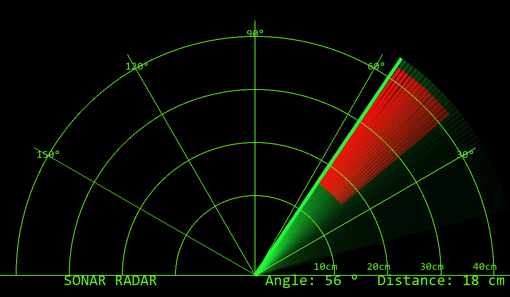

<div align="center">

# 📡 Arduino Sonar Radar

### Build a working radar for the price of a pizza

**An ultrasonic sensor on a servo sweeps 150°, an Arduino measures distance at every degree, and a Processing
sketch draws it all live as a classic green radar screen — with intruders painted red.**




<sub>The radar display (rendered here with simulated readings: an object 18 cm away at 40–58°).</sub>

</div>

---

## How it works

1. A **servo** rotates the **HC-SR04 ultrasonic sensor** from 15° to 165° and back, one degree every 30 ms.
2. At each angle the Arduino fires a 10 µs pulse and times the echo: `distance = duration × 0.034 / 2` cm.
3. It sends `angle,distance.` over USB serial (9600 baud).
4. The **Processing** sketch reads each reading, draws the sweep line with a fading trail, and paints anything
   closer than 40 cm in **red** at its real angle and distance.

## Parts

| Part | Qty |
|---|---|
| Arduino Uno (or Nano) | 1 |
| HC-SR04 ultrasonic sensor | 1 |
| SG90 micro servo | 1 |
| Jumper wires + USB cable | — |

## Wiring

| HC-SR04 / Servo pin | Arduino pin |
|---|---|
| Sensor **VCC** | 5V |
| Sensor **GND** | GND |
| Sensor **Trig** | D10 |
| Sensor **Echo** | D11 |
| Servo **signal** (orange) | D12 |
| Servo **power** (red) / **ground** (brown) | 5V / GND |

Glue or tape the sensor on top of the servo horn so it turns with it.

## Run it

1. Open **`arduino/radar/radar.ino`** in the Arduino IDE and upload it to the board.
2. Install [Processing 4](https://processing.org/download), open **`processing/radar_display/radar_display.pde`**.
3. Set your serial port on this line (Arduino IDE → Tools → Port shows it):
   ```java
   myPort = new Serial(this, "COM6", 9600);   // e.g. "COM3" on Windows, "/dev/ttyUSB0" on Linux
   ```
4. Press **Run**. Wave your hand in front of the sensor.

If your screen is smaller than 1200 × 700, change `size(1200, 700)` at the top of the sketch.

## Ideas to extend it

Beep louder as objects get closer (piezo buzzer) · log detections to a file · swap in a longer-range sensor ·
mount it on a robot car for obstacle mapping.
